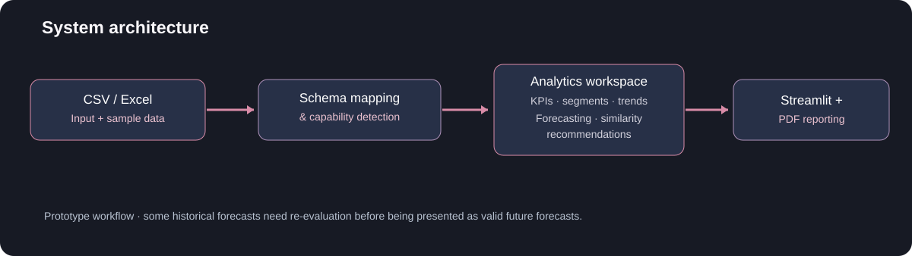
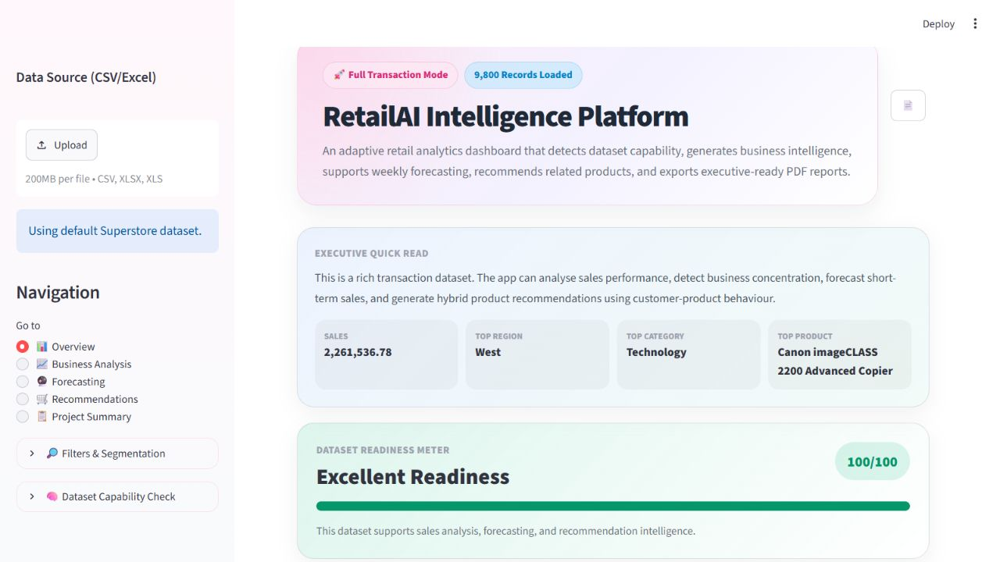
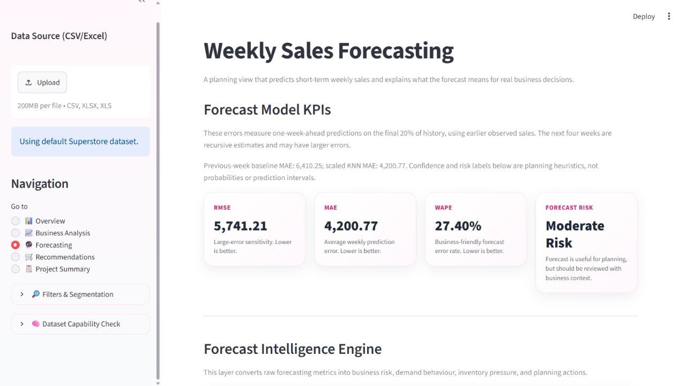

<p align="center"></p>

<p align="center"><strong>Explore sales · Forecast patterns · Discover product relationships · Export insight</strong></p>
<p align="center">
<a href="https://retailai-adaptive-intelligence.streamlit.app/">Live app</a> · <a href="https://github.com/SiobhanGoh/RetailAI-Adaptive-Sales-Intelligence">Source</a> · <a href="#walkthrough">Walkthrough</a> · <a href="#methods-and-evidence">Methods &amp; evidence</a> · <a href="#run-locally">Run locally</a>
</p>

## Overview

**RetailAI** is a modular Python/Streamlit portfolio prototype for exploring retail transaction data. It combines **business intelligence**, **feature-aware data ingestion**, **sales forecasting**, **product-similarity recommendations** and **downloadable executive reporting** in a single workflow. Available analytical sections depend on the fields in the uploaded dataset.

> **Project status:** Analytics prototype with corrected date handling and historical-only forecast features. See [Evaluation and limitations](#evaluation-and-limitations) for the retrospective evaluation protocol and remaining limits.

## At a glance

| Analytics & BI | Machine learning | Product experience |
|---|---|---|
| Revenue/order KPIs, category and regional analysis, Pareto trends, business narratives | Time-aggregated sales modelling and hybrid content/transaction similarity recommendations | CSV/Excel uploads, adaptive feature availability, modular pages and PDF exports |

## Walkthrough

1. **Load and inspect:** select the bundled example or upload CSV/Excel; detect known sales, date, product, category, region and customer fields.
2. **Understand the business:** explore sales patterns, composition and concentration in interactive dashboards.
3. **Model sales:** inspect weekly time-series forecasts *as an experimental feature*; methodology and known validation issues are disclosed below.
4. **Recommend products:** choose TF-IDF/cosine content similarity or a blended transaction/content approach when customer history is available.
5. **Export a report:** generate an executive-oriented PDF combining compatible modules and plain-language interpretations.

<p align="center"></p>

<details>
<summary><strong>Explore the repository structure</strong></summary>

```text
app.py
app_pages/
  overview.py
  business_analysis.py
  forecasting.py
  recommendations.py
  project_summary.py
utils/
  data_loader.py
  column_mapper.py
  adaptive_utils.py
  forecasting_utils.py
  recommendation_utils.py
  interpretation_utils.py
  insight_utils.py
  pdf_report.py
data/
requirements.txt
```

The project is arranged as a multi-page Streamlit application with separate data, modelling, visualisation and reporting utilities.
</details>

## App screenshots

Actual local app screens captured with the corrected bundled-data pipeline on 22 October 2026.





## Methods and evidence

### 1 · Analytics and adaptive data handling

`utils/data_loader.py`, `column_mapper.py` and `adaptive_utils.py` load files, map common column names, standardise values and determine which sections are applicable. The dashboards support category/region/customer/product summaries and composition views. Interpretations are **rules and heuristics**, not responses from a generative language model.

### 2 · Forecasting research

The original research compared **12 weekly regression model families** on 209 aggregated weeks, with 197 feature-complete rows and a chronological **157/40** split. The selected research KNN used scaling, five Euclidean neighbours and uniform weights; 24 KNN settings were explored on the same holdout. These saved comparisons are **model-selection evidence**, not an untouched external assessment.

<details>
<summary><strong>View exploratory saved benchmark figures</strong></summary>

| Weekly research KNN | Saved selected-split value |
|---|---:|
| MAE | 4,200.77 sales units |
| RMSE | 5,741.21 sales units |
| R² | 0.404 |
| WAPE | 27.40% |

Source: [`data/weekly_forecast_benchmark_results.csv`](data/weekly_forecast_benchmark_results.csv) and [`data/final_forecasting_summary.csv`](data/final_forecasting_summary.csv). **These are exploratory research-selection numbers and do not validate the deployed app's forecasting path.** The benchmark's selection holdout was reused for tuning; a clean, frozen evaluation is a planned next step.
</details>

### 3 · Recommendations

The source contains a customer–product sales pivot for collaborative item similarity, product text transformed with **TF-IDF**, cosine-similarity scoring and a conditional blended recommender. `utils/recommendation_utils.py` uses a **70/30 transaction/content** blend when transaction similarity is sufficiently informative, otherwise a **20/80** blend favouring content. No offline ranking benchmark, conversion uplift or revenue impact has been established.

### 4 · Executive reporting

`utils/pdf_report.py` generates reports with tables, figures, business interpretations and appropriate fallback sections when a dataset lacks required fields.

<details>
<summary><strong>Tech stack and implementation notes</strong></summary>

**Python · Streamlit · Pandas · NumPy · scikit-learn · Plotly · Matplotlib · ReportLab · openpyxl**

Relevant source entry points: `app.py`, `utils/data_loader.py`, `utils/forecasting_utils.py`, `utils/recommendation_utils.py`, `utils/pdf_report.py`. The application runs models and analytics at interaction time; it is not an AutoML, database-backed or authenticated SaaS platform.
</details>

## Run locally

```bash
git clone https://github.com/SiobhanGoh/RetailAI-Adaptive-Sales-Intelligence.git
cd RetailAI-Adaptive-Sales-Intelligence
python -m venv .venv
# Activate your environment (Windows: .venv\Scripts\activate; macOS/Linux: source .venv/bin/activate)
python -m pip install -r requirements.txt
python -m streamlit run app.py
```

Use Python 3.12 and the versions in `requirements.txt`. Run `python -m pytest -q tests` after installing `pytest` to check date handling and forecasting invariants.

## Verified repair results

The bundled dataset now retains **9,800 records**, with sales totalling **2,261,536.7827**. The first row's order date is correctly read as **8 November 2017**. Six data/forecast regression checks and five default-page checks passed on Windows with Python 3.12.

| Corrected one-week-ahead evaluation | Result |
|---|---:|
| Training / evaluation weeks | 157 / 40 |
| Scaled KNN MAE | 4,200.77 |
| Scaled KNN RMSE | 5,741.21 |
| Scaled KNN R² | 0.4040 |
| Scaled KNN WAPE | 27.40% |
| Previous-week baseline MAE | 6,410.25 |
| Previous-week baseline RMSE | 7,448.08 |

Reproduce with `python scripts/verify_repair.py`. [Aggregate evidence](verification/corrected_evaluation.json) and [dated predictions](verification/one_step_predictions.csv) are included. These reproduce historical research values after aligning the app pipeline; the historical selection holdout was already explored, so this is **not a new independent accuracy claim**.

## Evaluation and limitations

**Corrections in this revision:**

- The bundled day/month/year dates use an explicit format. Uploaded data exposes a day-first/month-first choice; ISO dates retain year-month-day ordering. Invalid order dates are reported.
- All forecast lags, rolling statistics and changes use only observations before the predicted week. Historical and future features use the same standard-deviation definition and calendar index.
- Both evaluation and final forecasting use a StandardScaler + five-neighbour KNN pipeline. Evaluation scaling is fitted only on the training period.
- The final 20% of eligible weeks is evaluated chronologically, with previous observed weeks available for each one-week-ahead prediction. A previous-week-sales baseline is scored on those same weeks. The model settings were fixed before this repair's evaluation and were not tuned against its results.
- Four-week future forecasts are recursive. Their errors are not established by the one-week-ahead evaluation, and can compound over the horizon.

**Remaining limits:** These are retrospective estimates on an already explored dataset, not independent external validation. The archived research CSVs above describe a different historical experiment and are not the corrected application's scores. Similarity scores are not purchase probabilities; confidence, inventory-pressure and business-health labels are heuristics, not calibrated probabilities or measured stock outcomes.

<details>
<summary><strong>Data provenance and responsible reuse</strong></summary>

The demo includes a Superstore-labelled CSV. Verify its licence and redistribution terms before republishing or creating derivatives. Remove any confidential user-uploaded content from screenshots and reports. The current repository also includes generated similarity artefacts; check their use and size before moving them out of version control.
</details>

## Next improvements

- [x] Correct date parsing, forecast leakage, scaling and prediction-time feature alignment.
- [x] Add real app screenshots.
- [x] Add regression checks for dates, leakage, feature parity and chronological evaluation.
- [ ] Confirm redistribution terms for the bundled sample data.
- [x] Remove tracked Python bytecode and ignore future cache files.
- [ ] Review large generated similarity artefacts before removing them.

---

**Siobhan Goh** · Master of Artificial Intelligence, Monash University Malaysia · [LinkedIn](https://www.linkedin.com/in/siobhan-goh/)