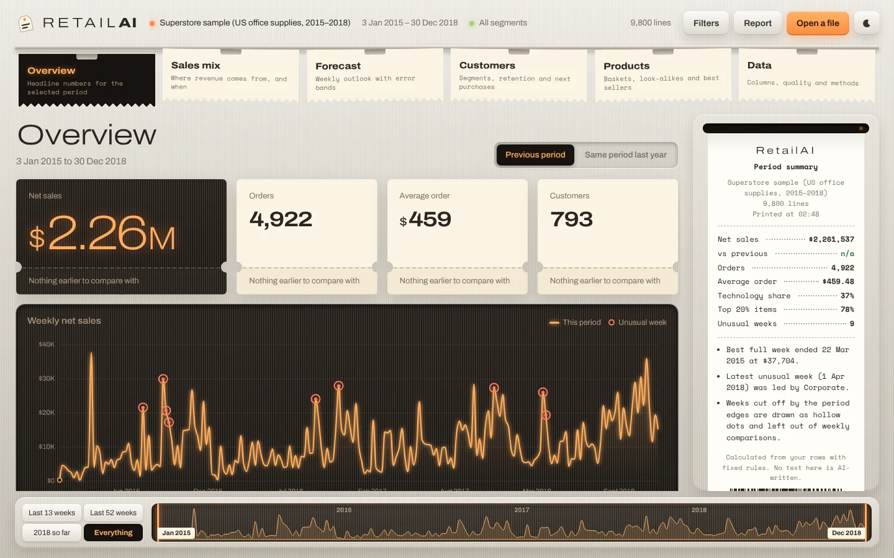
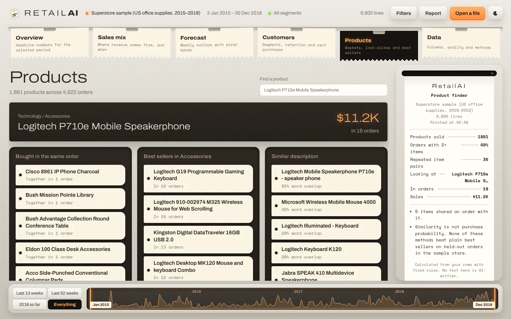
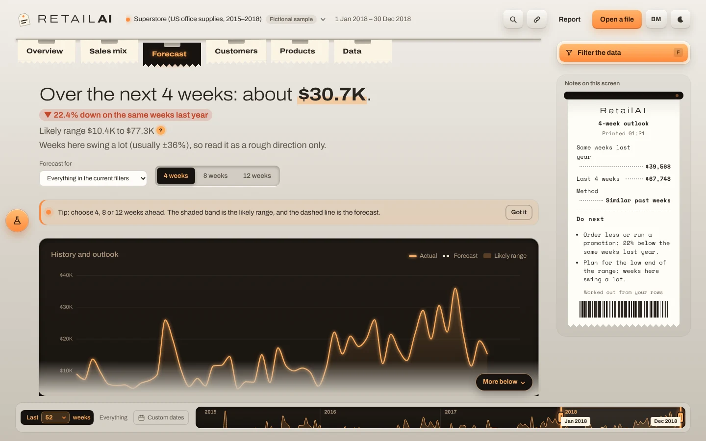
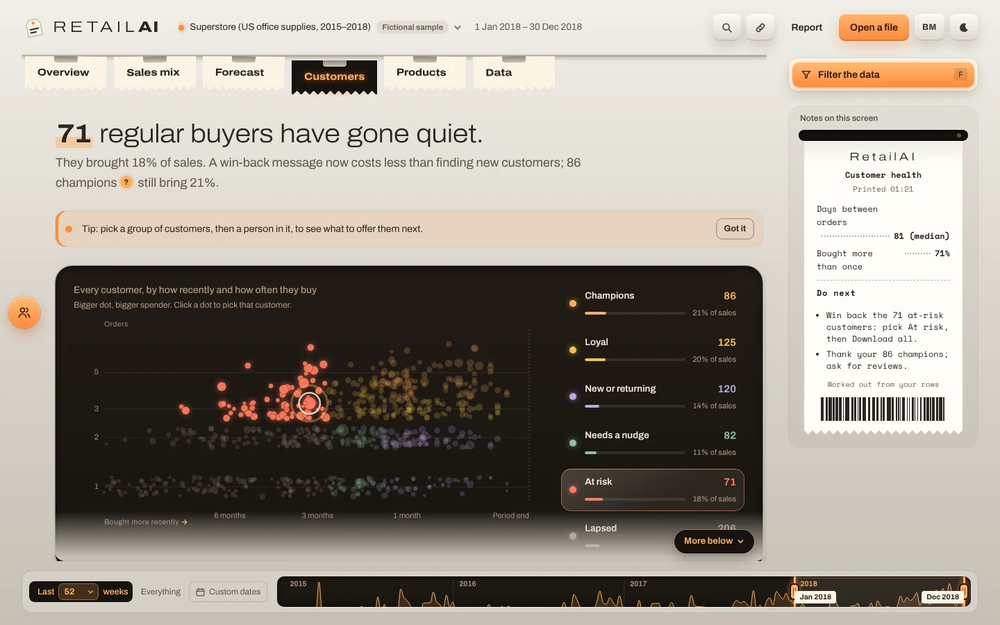
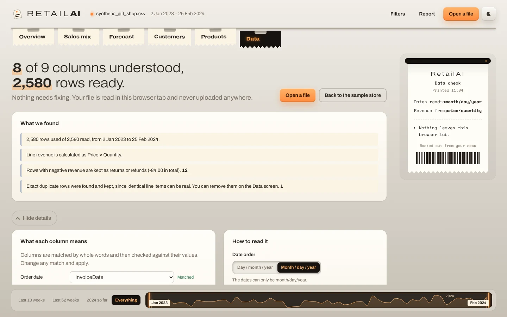
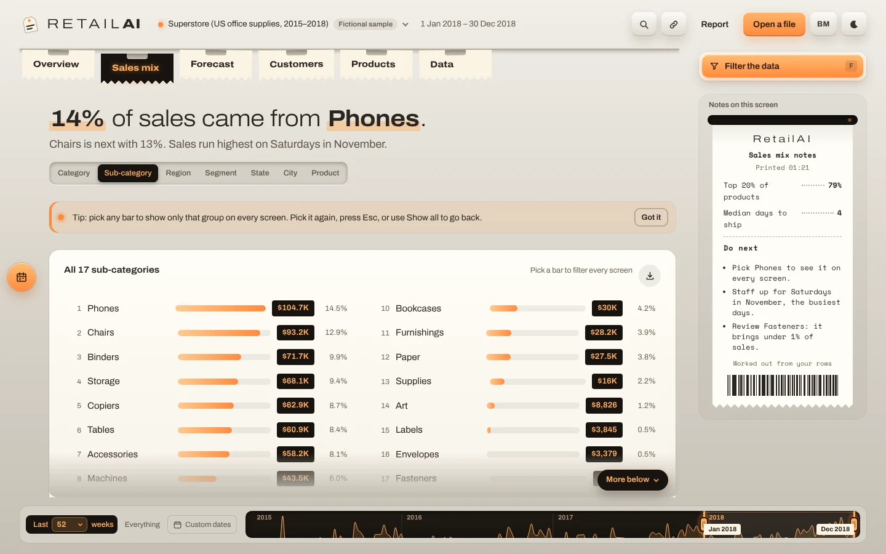
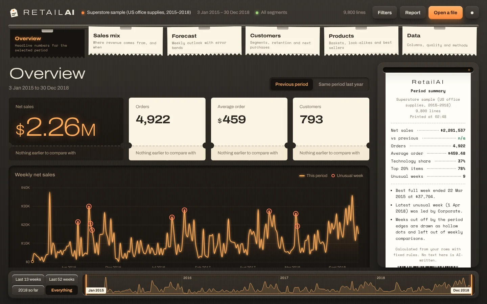
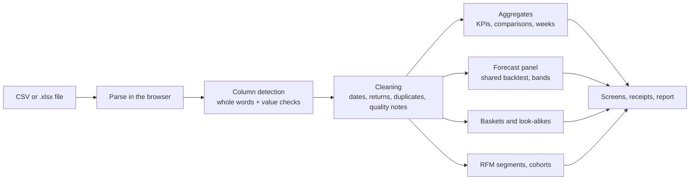

<p align="center"></p>

# RetailAI

**Open a sales export and get trends, forecasts with error bands, customer segments and product pairings, all calculated in your browser.**

RetailAI reads a CSV or Excel file of orders, works out what each column means, and turns it into six screens. The screens are order tickets hanging on a rail, and each one prints its own receipt of notes. Nothing is uploaded: the file stays in the browser tab, so the app can be hosted as a plain static site that never sleeps.

Version 2 replaces the earlier Streamlit prototype. What changed, and what is still open, is listed at the end of this page.

## What it does

| Screen | What you get |
|---|---|
| **Overview** | Net sales, orders, average order and customers, each compared with the previous period and the same period last year. Weekly sales with unusual weeks marked and explained by the categories or regions that moved. |
| **Sales mix** | Sales by category, sub-category, region, segment, state, city or product (select a bar to filter everything), a weekday × month pattern, a concentration curve, margin when there is a profit column, shipping times. |
| **Forecast** | 4, 8 or 12 weeks ahead for the whole store or one segment. Four models are replayed on past weeks; the lowest-error one is used and the 80% band comes from its past errors. If the period ends early, the chart also shows what actually happened. |
| **Customers** | Recency × frequency grid, six named segments with suggested actions and CSV export, quarterly retention cohorts, and next-purchase ideas for any customer. |
| **Products** | For any product: items bought in the same order, best sellers in its sub-category, and look-alikes by description. Repeated item pairs and sub-category pairs with lift. |
| **Data** | The detected column mapping (editable), date order, duplicate handling, currency, a quality report and how every number is made. |

A printable **report** (save as PDF from the print dialog) collects the headline numbers, breakdowns, the 4-week outlook and segments for the current filters.

<p align="center">




</p>
<p align="center">


</p>

## How it works



- **Column detection** splits headers into words (`orderDate` → order, date) and checks the values, so `statement_no` is never a state, `unit_price` is never treated as line revenue, `ship_date` is never the order date and a `sales_rep` column of names is rejected. If only price and quantity exist, revenue is price × quantity. Any match can be changed on the Data screen.
- **Cleaning** keeps negative rows as returns, keeps exact duplicate rows unless you remove them, and reports both. When the order ID is missing, a customer's purchases on one day become one order. Day-first or month-first is detected from the values when they decide it, and you can switch it.
- **Weeks** end on Sunday. Weeks the data only partly covers are drawn hollow and never used to train or score a forecast.
- **Unusual weeks** are at least 4 robust deviations from the median of the previous 13 full weeks, and come with the categories, regions or segments that moved most in the same direction.

## Evidence

All figures below come from `npm run evaluate` (`scripts/evaluate.ts`), which writes [`verification/web_evaluation.json`](verification/web_evaluation.json). The protocol was fixed before looking at test results.

**Port check.** Re-implementing the original Python features, split and scaled 5-neighbour KNN in TypeScript gives a one-week-ahead MAE of **4,200.77** (previous-week baseline 6,410.25), matching the archived Python result exactly.

**Forecast panel.** 208 complete weeks; recursive forecasts from 62 origins (22 Oct 2017 to 23 Dec 2018). The app picks the lowest-error model on the whole replay, which flatters it, so here the model is chosen on the earlier half of origins and scored on the later half.

| Later origins, WAPE | 4 weeks ahead | 12 weeks ahead |
|---|---:|---:|
| Holt–Winters | 32.5% | 31.6% |
| Nearest-neighbour (picked on earlier origins) | 33.8% | 36.9% |
| Average of last 4 weeks | 34.3% | 35.1% |
| Same week last year | 34.8% | 34.3% |
| 80% band coverage of the picked model | 69.5% | 57.2% |

The models sit within about 2 points of each other at 4 weeks, the earlier-half pick was not the later-half winner, and the bands are too narrow. The app says this next to the forecast on the sample store.

**Product suggestions.** The same basket-completion task as the archived Python test: train up to 6 April 2018, then for each known item in a later multi-item order, try to find the other items in that order (1,936 queries). Strategies were compared on a validation window inside the training period first.

| Method | Hit rate@5 | Recall@5 | Catalogue shown |
|---|---:|---:|---:|
| Two best sellers, then sub-category best sellers (validation winner) | 2.12% | 0.73% | 3.8% |
| Best sellers overall | 2.01% | 0.67% | 0.3% |
| Similar description (TF-IDF) | 1.81% | 0.86% | 74.7% |
| Bought together, then best sellers | 1.39% | 0.40% | 88.4% |

Superstore baskets rarely repeat, so nothing beats plain best sellers by a meaningful margin. The app shows each kind of suggestion as its own labelled list with its evidence ("Together in 2 orders", "82% word overlap") instead of presenting a blended score as a prediction.

**Customer next purchase.** For 642 customers active on both sides of the cutoff, the validation pick (best sellers in the sub-categories they buy most) matched a new later purchase for 1.56% of customers, against 2.18% for plain best sellers. The app says so beside the list.

The archived Python results ([`verification/corrected_evaluation.json`](verification/corrected_evaluation.json), [`extended_evaluation.json`](verification/extended_evaluation.json)) are unchanged and still reproducible from `research/`. Their `source_sha256` was computed on a Windows (CRLF) checkout of the CSV; a Linux (LF) checkout hashes differently but gives the same results.

**Limits.** This is retrospective evaluation on one public sample that has already been explored. Overlapping forecast windows and queries from the same order are not independent. Segment names and unusual-week flags are fixed rules, not predictions. The receipts are calculated text, not AI-written.

## Run it

```bash
git clone https://github.com/SiobhanGoh/RetailAI-Adaptive-Sales-Intelligence.git
cd RetailAI-Adaptive-Sales-Intelligence
npm ci
npm run dev          # http://localhost:5173
npm test             # engine tests
npm run evaluate     # regenerates verification/web_evaluation.json
npm run build        # static site in dist/
```

Node 20 or newer. Keyboard: 1–6 switch screens, F filters, P report, U open a file.

**Hosting.** `dist/` is a static site.
- *GitHub Pages:* in repository Settings → Pages, set Source to "GitHub Actions". The included workflow then builds and deploys on every push to `main`.
- *Cloudflare Pages:* connect the repository with build command `npm run build` and output directory `dist`.

## Repository layout

```text
src/engine/       analytics engine (plain TypeScript, no UI): mapping, cleaning, aggregates,
                  forecast, recommend, customers, anomalies
src/modules/      the six screens and the report
src/ui/, charts/  ticket rail, receipt printer, period strip, filters, charts
test/             engine tests and a small synthetic messy fixture
scripts/          evaluate.ts (evidence above), screenshots.mjs (README images)
data/             superstore_sales.csv, the bundled sample
verification/     evaluation outputs
research/         the original Python pipeline and tests, kept to reproduce archived results
```

## Data

The bundled `data/superstore_sales.csv` is the widely shared "Superstore Sales" sample (9,800 order lines, 2015–2018). Its redistribution terms have not been confirmed; check them before republishing. `test/fixtures/synthetic_gift_shop.csv` is generated test data, not real sales.

## What changed from version 1

- **Speed:** the PDF report was built twice on every click and models were retrained on every interaction. Now work is computed once per change and the report is built only when opened.
- **Size:** about 19 MB of generated CSVs that the app never read, including a 16 MB similarity matrix, are gone. Three small benchmark tables are kept in `research/archive/`. Similarity is computed on demand, without a products × products matrix.
- **Column detection:** the old substring matching could treat price or totals as revenue, IDs as names and ship dates as order dates. It now matches whole words, checks values and can be edited.
- **Cleaning:** returns and duplicate rows were silently dropped. They are now kept and reported.
- **New inputs:** quantity, profit, discount and currency are understood.
- **Average order:** it was per row, and is now per order.
- **Forecasting:**
  - It was a single model with a confidence score made up from fixed weights.
  - Now there are four models, chosen on a replay of past weeks, with error bands.
  - Partial weeks are handled.
  - There are segment forecasts, a choice of horizon, and a comparison with what actually happened when there is data after the period.
- **Recommendations:** suggestions used to come from customer-level spend, keyed by product name. They now come from order baskets keyed by product ID, with honest labels.
- **Honest labelling:** the "business health score" was really a dataset-size score, and several rule-based heuristics were branded as AI. These are removed or renamed.
- **New features:** date range, comparisons, filters with reset, customer segments and cohorts, item and sub-category pairing, unusual-week drivers, and CSV exports.
- **Hosting:** the app moved off Streamlit to a static site that does not sleep.

Still open: confirming the sample data's licence, and turning on GitHub Pages or Cloudflare Pages for the live link.

---

**Siobhan Goh** · Master of Artificial Intelligence, Monash University Malaysia · [LinkedIn](https://www.linkedin.com/in/siobhan-goh/)
